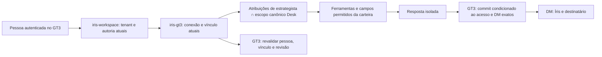

# Íris no GT3 — integração por workspace

Estado em 27/10/2026: publicado em produção mediante autorização expressa do
usuário, com primeiro teste real restrito a Bruno Rodrigues Guzela. A Íris usa
identidade de robô própria, conversa privada e carteira derivada no servidor.
O teste inicial associou somente Bruno à carteira de Jin (24 clientes). A pedido
do usuário, o vínculo foi depois trocado para Luis Fonseca (30 clientes), em modo teste;
nenhum outro destinatário foi liberado.

**Estado operacional: piloto ativo somente para Bruno, em modo teste, carteira de Luis com 30 clientes; configuração de aviso às 08:00 America/Sao_Paulo, de segunda a sexta.**
Luis possui acesso ao chat, mas não a `automacoes-wa/ver`. O vínculo ativo do GT3
concede acesso próprio aos alertas operacionais da carteira, sem abrir o painel
de automações. Relatórios e avisos diários incluem avaliação contextual de
satisfação pelas conversas autorizadas, com indicação de período e cobertura.
Pausa e reativação conferidas pela interface; dias úteis restaurados e configuração
final conferida no banco. A foto escolhida pelo usuário está no commit `9c2321ab`;
a foto foi conferida visualmente no perfil, cabeçalho, lista e mensagens, com rótulo de robô preservado.

## Experiência e cadastro

1. No GT3, um administrador abre **Configurações → Integrações → Íris**. Copia o
   ID do workspace ou usa o link para o Desk; esse link contém somente o ID público.
2. No Desk, um administrador com `automacoes-wa/admin` gera um código de uso único
   para aquele workspace. O código expira em dez minutos; não entra em URL,
   armazenamento do navegador ou logs. É copiado manualmente para o GT3.
3. O servidor GT3 troca o código por credencial limitada à conexão. A conexão
   começa pausada. O segredo fica no Vault do GT3; no Desk há somente seu SHA-256.
   A credencial expira em 90 dias. A troca exige também autenticação da ponte
   servidor a servidor, além do JWT do administrador atual do GT3.
4. O administrador associa uma pessoa ativa do GT3 a um estrategista ativo do
   Desk. A tela mostra a carteira autorizada. Não há associação por semelhança de
   nomes. O modo teste mantém a identidade real e as atribuições canônicas intactas.
5. Depois de conferir o cadastro, salva a ativação, horário, fuso, dias e tipos
   de alerta. O botão de teste da UI envia somente à própria conta autenticada,
   com vínculo ativo em modo teste. Não há destinatários cadastrados por padrão.
6. A Íris aparece no chat com nome, avatar e identificação de robô. A conversa
   desta versão aceita texto. Não oferece agenda ou agendamento de reuniões.

Pausar a integração impede novas respostas/avisos; mensagens já autorizadas ficam
legíveis. Pausar um destinatário, trocar sua associação ou revogar a conexão
retira o acesso à DM antiga e preserva o registro. A reativação abre uma nova DM.
O modelo e esforço de raciocínio seguem as escolhas existentes do operador.

A lista de estrategistas permite preparar a associação de administradores,
gerentes e estrategistas ativos mesmo antes de receberem clientes. Pessoas
ativas de outros perfis internos continuam elegíveis quando já possuem
atribuições de estrategista; perfis de cliente ficam excluídos. Essa lista não
concede carteira: sem atribuições autorizadas, a associação tem zero clientes.

### Acompanhar os avisos

Na mesma tela, **Últimas entregas** mostra os 30 registros mais recentes da
conexão atual, com data, pessoa, tipo, modo teste, resultado e código de falha.
O administrador usa **Atualizar** para recarregar; não há filtros, paginação ou
atualização periódica. O link de conversa aparece somente para a própria conta.
Uma falha pode ser tentada novamente automaticamente no diário, até três
tentativas; a mesma linha muda de estado e só “Enviado” confirma a entrega.

## Fronteiras e política de dados

- Identidade/tenant vêm da sessão validada no servidor. O navegador não escolhe
  persona, carteira, histórico ou empresa. Mesmo um administrador do Desk fica
  restrito às suas atribuições de estrategista neste canal.
- A credencial vale para um par empresa Desk/workspace GT3. O endpoint fixo de
  cada projeto é configurado no servidor, HTTPS `*.supabase.co`, sem redirects
  ou destino informado pelo usuário. Corpos e respostas têm limite; erros não
  serializam tokens, JWTs, código, texto interno ou stack.
- A ação `conectar` exige `IRIS_BRIDGE_SECRET`, segredo servidor a servidor,
  além do código e JWT humano. A UI do GT3 nunca recebe o token resultante.
- Ferramentas permitidas: ajuda, buscar cliente, relatório da própria carteira, alertas, situação, satisfação,
  contratos sem valores, resumo e histórico do próprio cliente. Chamadas forjadas
  são bloqueadas antes de consultar ou escrever. Não há ferramentas de empresa,
  equipe, financeiro, comissão, agenda ou aprendizado global neste canal.
- O relatório lista nomes, estado ativo e situação contratual sem valores, em
  páginas de 50 clientes (máximo 100), somente dentro do tenant e IDs do escopo.
  O vínculo ativo concede `alertasCarteiraGt3`, somente neste canal e nesta carteira.
  Sem a permissão geral de automações, usa o coletor privado com regras operacionais
  conhecidas, sem consultar configurações, ignorados ou análises do painel.
  Uma consulta vazia devolve somente o resultado limitado às fontes consultadas;
  falha de leitura tem resposta explícita de indisponibilidade, inclusive depois
  de uma busca bem-sucedida. A política `carteira-gt3-v6` invalida o contexto anterior.
  A saída do GT3 preserva negrito e até 8 mil caracteres (16 mil bytes UTF-8) numa única mensagem,
  mantendo máscaras e verificações de saída; o limite do WhatsApp continua separado.
- Satisfação e risco contextuais usam a mesma IA configurada para a resposta,
  a partir de uma amostra de até 12 mensagens por cliente nos últimos 30 dias.
  Há até 400 mensagens autorizadas para métricas, 3.500 caracteres por transcrição
  e orçamento total de 120 mil caracteres por página. A análise não grava
  satisfação administrativa nem aprendizado global. Ausência de fala do cliente
  na amostra significa satisfação indeterminada, não satisfação positiva ou risco baixo.
  O aviso diário usa esse mesmo fluxo contextual, com os tipos configurados e
  revalidação do vínculo e do escopo antes da entrega; erros não viram relatório vazio.
- Projeções de saída usam campos permitidos. Valores monetários explícitos e
  contatos/documentos completos são mascarados também no resumo diário.
  Texto não confiável não modifica a autorização. O perfil administrativo e os
  aprendizados globais do WhatsApp não entram no prompt do GT3.
- Memória de conversa pertence ao servidor Desk, por conexão, pessoa e hash do
  escopo; lê até oito mensagens das últimas 48 horas. O hash inclui política,
  conexões/vínculos e revisões, clientes atuais, permissões e instâncias. Não é
  treinamento do modelo nem aprendizado passivo das mensagens do workspace.
  As linhas antigas não são apagadas automaticamente por esta implementação.
- O aviso filtra clientes antes de contagens/texto; não revela grupos sem cliente,
  carteiras de colegas ou métricas da empresa. Sem alertas registra envio dispensado.
- A análise ampla `cliente_relacionamento` só é consultada se o estrategista Desk
  tiver perfil admin/gerente ativo, profile coerente com o tenant e permissão
  `automacoes-wa/admin`, espelhando a autorização canônica da fonte. Essa
  capacidade entra no hash do contexto. A carteira continua limitada mesmo assim.
  Para os demais, histórico/situação/satisfação usam a timeline com as instâncias
  permitidas. O aviso consulta apenas metadados de conversas comprovadas por essa
  timeline e status/datas de contratos da carteira, sem análises administrativas.
  A categoria de sentimento dessas conversas tem cobertura limitada; queda de
  volume não é calculada sem uma contagem completa autorizada. Essas limitações
  aparecem no aviso, inclusive quando não há itens: não se afirma que está tudo
  bem nem se apresenta uma consulta parcial como análise completa.
- O robô é uma conta de sistema sem papel admin e com login humano bloqueado.
  Registro de tipo próprio impede uso acidental da Íris como bot de anúncios.
- DM exige exatamente robô e destinatário; RLS, funções de leitura e gatilhos
  protegem contra terceiros, mudanças de membros e canais antigos revogados.
  Push usa texto genérico; DMs da Íris ficam fora do digest de e-mail geral.

O Desk confere o escopo antes e depois da geração e consulta o estado atual do
GT3 por callback autenticado. O GT3 grava mensagem e estado de entrega na mesma
transação, condicionada às revisões locais, lease e destinatário/DM válidos.
**Não há transação distribuída entre os dois bancos**: existe um intervalo de
rede entre a última conferência Desk e o commit GT3. Não se promete revogação
instantânea nesse intervalo. Mudanças locais são rechecadas no commit; chamadas
seguintes recalculam todo o escopo.

## Componentes e publicação em produção

| Projeto | Componentes novos |
|---|---|
| Desk | `iris-gt3`, política/projeções, dados e coleta restrita `iris-gt3-*`, autorização em Íris → Integração GT3 |
| GT3 | `iris-workspace`, `iris-daily`, contrato/serviço e notificações compartilhados, UI e identidade de robô |
| Desk SQL | `20261027213657_iris_gt3_connection_scope.sql`: código, conexão, vínculo, contexto e pedidos; RPCs só de serviço |
| GT3 SQL | `20261027213540_iris_workspace_chat.sql`: conexão/Vault, destinatários, robô, DM, entregas, guards e cron |

Tabelas novas têm RLS, privilégios explícitos e nenhuma leitura direta pelo
navegador. As migrations são adicionais; não reescrevem histórico já aplicado.

Configuração **somente do servidor**, provisionada nos projetos autorizados; nenhum valor de segredo é reproduzido neste documento:

| Projeto | Variável | Finalidade |
|---|---|---|
| Desk | `GT3_SUPABASE_URL`, `GT3_SUPABASE_ANON_KEY` | Validar sessão GT3 e callback; URL/key públicos do projeto correto |
| GT3 | `IRIS_DESK_URL` | URL Supabase fixa do Desk, sem caminho de endpoint |
| Ambos | `IRIS_BRIDGE_SECRET` | Mesmo segredo aleatório, mínimo 32 caracteres; nunca prefixo `VITE_` |
| GT3 | `CRON_SECRET` e registro Vault existente | Autenticar cron; ausência fecha o job |

Os demais segredos de auth, modelo e push já são do próprio projeto. Não se
compartilha `service_role` entre aplicações. Funções `iris-gt3` e `iris-daily`
usam autenticação própria por ação (`verify_jwt=false`); `iris-workspace` exige
JWT e valida usuário ativo, tenant e papel no handler.

Publicação autorizada pelo usuário: “Autorizo produção e teste só comigo”. Os
PRs Desk #14 (`57a1bb6`) e GT3 #25 (`d32d7ef`) foram integrados à `main`.
As correções seguintes foram publicadas: nome do tenant no Desk (`d10628869`) e
prévias/prontidão do chat no GT3 (`a3a267e5`). Os identificadores dos commits de
publicação são os informados no registro operacional; não devem ser confundidos
com uma nova publicação deste documento.

| Projeto | Registro efetivo em produção | Versão |
|---|---|---|
| Desk `wuzmckatbmlpkdxtfhqr` | `iris_gt3_connection_scope` | `20261027221159` |
| GT3 `opbdoulspzlabxzevffc` | `iris_workspace_chat` | `20261027222022` |
| GT3 | `iris_chat_previews_indexed` — correção aprovada separadamente | `20261027223439` |

As versões efetivas podem diferir do prefixo do arquivo preparado localmente.
Não reaplicar migrations nem repetir configuração de segredos para alinhar nomes.
Foram publicados `iris-gt3`, `iris-workspace`, `iris-daily` e a correção delimitada
`send-chat-notification`. Os gates JWT/autenticação por ação foram conferidos.
A revisão de catálogo das 11 tabelas novas, ACLs/RPCs e uso de Vault não apontou
achados nessa conferência; isso não equivale a teste adversarial completo de RLS.

## Homologação controlada em produção

- Conta real de Bruno confirmada pela sessão e ID; único vínculo ativo em modo
  teste, associado explicitamente à carteira de Jin, com 24 clientes.
- Robô Íris membro, sem papel admin e com login banido; DM com exatamente dois
  participantes: robô e Bruno. Não houve impersonação do usuário.
- Teste privado registrado como enviado às 19:30 BRT. Pergunta sobre o cliente
  próprio ROCKET respondida; pedidos relativos a Erick, financeiro e informações
  da empresa recusados no teste observado. Nenhuma liberação para outros usuários.
- Cron `iris-daily-every-five-minutes` ativo; execução às 19:25 BRT com estado
  `succeeded` e HTTP 200 da Edge, 316 ms, na mesma janela. Naquela primeira leitura
  ainda não havia conexões; ela comprova transporte. O cron também entregou o aviso diário só a Bruno às 19:40:04 BRT após a ativação.
- A publicação inicial causou timeout em `get_chat_last_messages`: o guard era
  executado por mensagem. A migration `20261027223439` materializa os canais
  autorizados e usa `LATERAL` com `ORDER BY/LIMIT 1`. As prévias foram restauradas
  visualmente, com HTTP 200 observado às 19:35 BRT. O frontend distingue falha,
  carregamento e vazio confirmado, e aguarda sessão/canal antes do envio.

Verificações locais: **186 testes únicos** aprovados, além de **69 reexecuções**
focadas; builds Vite dos dois projetos e checagens Deno pertinentes passaram.
A tipagem global possui pendências preexistentes e não é declarada integralmente
aprovada por este registro. Os testes sintéticos usam rede negada e não criaram
banco auxiliar. A observação real acima complementa os testes locais.

Continuam **não exercitados em produção**: acesso com uma segunda conta real,
corridas concorrentes de revogação/troca durante geração e comportamento de mute.
Pausa/reativação e dias úteis finais conferidos. A foto do usuário foi aplicada e conferida no chat de produção. Novos destinatários exigem avaliação
separada; a autorização desta rodada foi somente para Bruno.

A política GT3 `carteira-gt3-v3` reforça a exclusão de agenda espontânea, inclusive referências históricas a pautas, convites, datas e horários relacionados. Resumo privado posterior ao ajuste conferido sem esse assunto.
