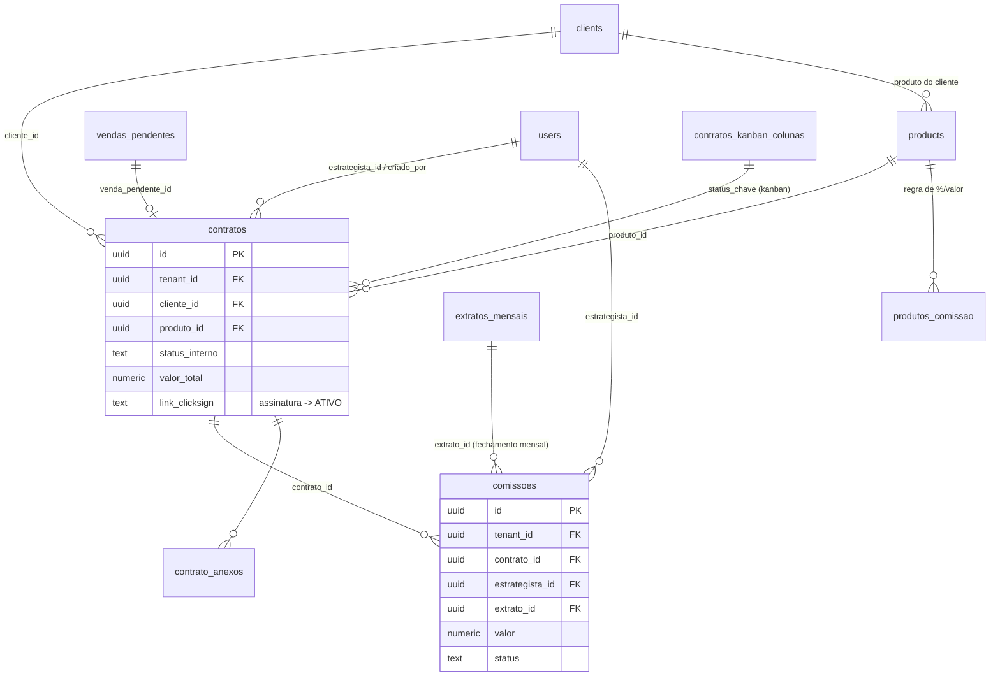
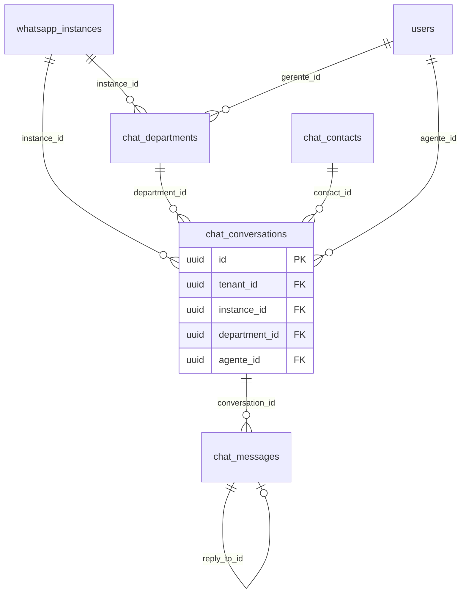
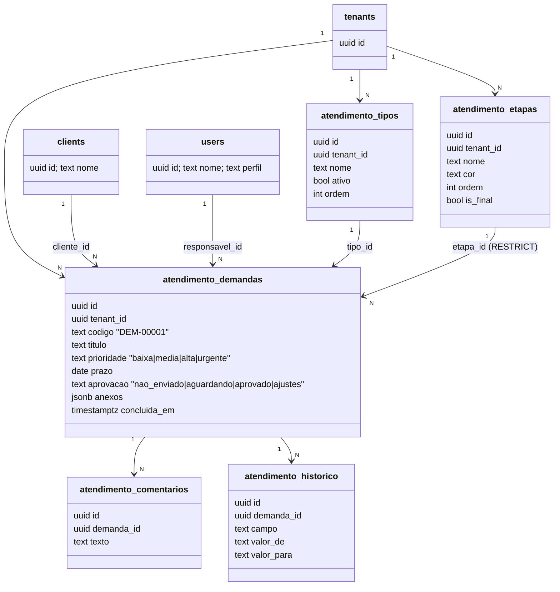
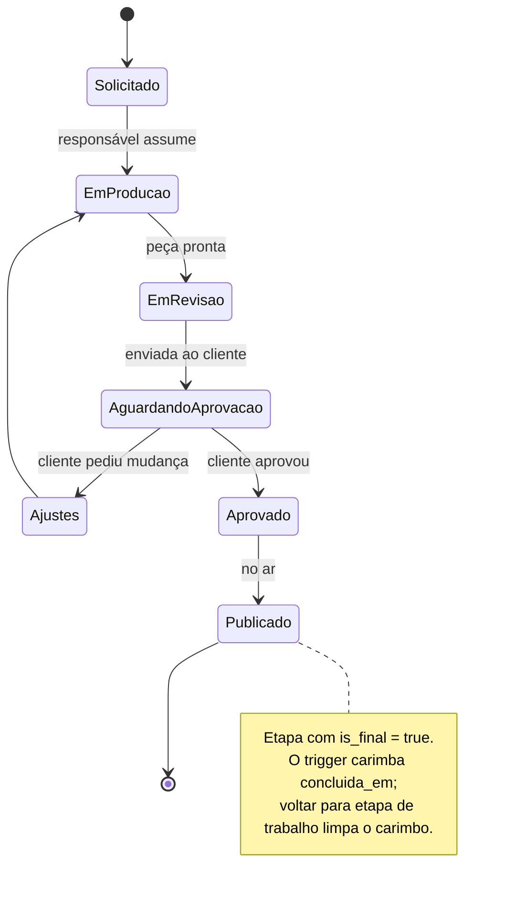
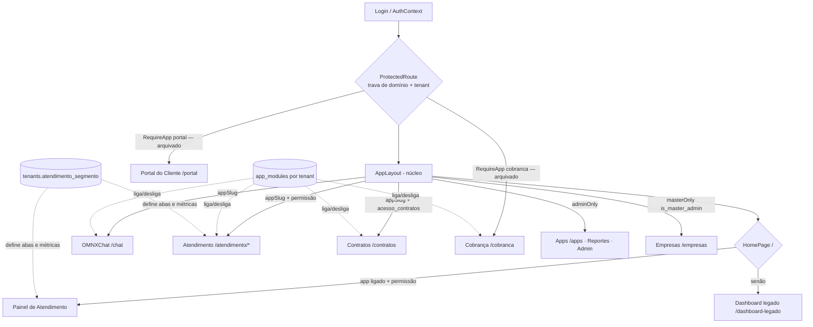

# UML — Modelo de entidades e fluxo dos apps (omnx-desk)

> Engenharia reversa do schema real em produção (`wuzmckatbmlpkdxtfhqr`), 115
> tabelas no schema `public`. Diagramas por domínio — um ER com 115 entidades
> seria ilegível, então o núcleo está detalhado e o resto agrupado.
> Atualizado em: 04/08/2026 BRT · inclui o app Atendimento (Fase 4).

---

## 1. Núcleo multi-tenant — `tenants` é o hub de tudo

Desde as Fases A/B do multi-tenant, **toda tabela de negócio tem `tenant_id NOT NULL`**
apontando para `tenants`. O isolamento é por linha (RLS `tenant_isolation`).

```mermaid
erDiagram
  tenants   ||--o{ profiles     : "1 pessoa = 1 tenant"
  tenants   ||--o{ user_roles   : "papel por tenant"
  tenants   ||--o{ app_modules  : "apps ligados"
  tenants   ||--o{ clients      : ""
  tenants   ||--o{ contratos    : ""
  tenants   ||--o{ whatsapp_instances : ""
  auth_users ||--|| profiles    : "user_id"
  auth_users ||--o{ user_roles  : "user_id"

  tenants {
    uuid id PK
    text name
    text slug
    bool is_master "só 1 mestre"
    text primary_color
  }
  profiles {
    uuid user_id PK_FK
    uuid tenant_id FK
    text full_name
  }
  user_roles {
    uuid user_id FK
    app_role role "admin|manager|member"
    uuid tenant_id FK
  }
  app_modules {
    uuid tenant_id PK_FK
    text slug PK "dashboard|chat|contratos|cobranca|portal"
    bool enabled
    uuid updated_by
  }
```

> **Provisionamento:** o tenant `...001` é o **MESTRE** (`is_master`). Um admin do
> mestre cria empresas novas (tela `/empresas` → `provision-tenant` → novo tenant +
> `handle_new_user` carimba `users`/`profiles`/`user_roles` no tenant novo +
> `seed_tenant`). O trigger `seed_apps_on_tenant_insert` semeia os 5 `app_modules`.

---

## 2. Domínio Contratos / Vendas / Comissões (o mais rico)



> Dívida conhecida (Fase 3): componentes de `/contratos` ainda moram em
> `src/pages/comissoes/`. O modelo de dados já é próprio; falta desenredar o front.

---

## 3. Domínio Chat (OMNXChat)



---

## 3.5. Domínio Atendimento (app Social Media — Fase 4)

O app nasce em 04/08/2026 com cinco tabelas. `atendimento_tipos` e
`atendimento_etapas` são **configuração por tenant**, não enum: é trocando esses
dois conjuntos que o mesmo app passa a atender outro segmento (clínica,
escritório) sem migration nova.



**Decisões que o diagrama não mostra:**

- `etapa_id` é **RESTRICT**, não CASCADE: o banco recusa apagar uma etapa que
  ainda tem demanda dentro. É a regra do §12 do brief aplicada onde não dá para
  contornar pela UI — o usuário precisa realocar antes.
- `aprovacao` é campo próprio, separado da etapa. Uma peça pode estar "em revisão
  interna" **e** já ter voltado com pedido de ajuste do cliente: são dois fatos.
- `atendimento_historico` é escrito por **trigger**, não pelo front. Assim a
  trilha registra a mudança venha ela da tela de detalhe, do kanban ou de uma
  correção manual no banco.

### Ciclo de vida da demanda



---

## 4. Mapa das 115 tabelas por domínio

| Domínio | Tabelas (principais) |
|---|---|
| **Multi-tenant / acesso** | `tenants`, `profiles`, `user_roles`, `users`, `employees`, `positions`, `employee_positions`, `app_modules`, `app_settings` |
| **Clientes** | `clients`, `client_assignments`, `client_contracts`, `client_notes`, `client_interactions`, `client_alerts` |
| **Contratos / Vendas / Comissões** | `contratos`, `contrato_anexos`, `contrato_modelos`, `contrato_tags`, `contratos_kanban_colunas`, `contratos_audit_log`, `vendas_pendentes`, `comissoes`, `extratos_mensais`, `produtos_comissao`, `products`, `salario_fixo_itens`, `pj_*` |
| **Chat (OMNXChat)** | `chat_conversations`, `chat_messages`, `chat_contacts`, `chat_departments`, `chat_department_agents`, `chat_csat`, `chat_quick_replies`, `chat_templates`, `whatsapp_instances`, `ia_bots`, `ia_bot_*`, `wa_warmup_*` |
| **Atendimento (Social Media)** | `atendimento_tipos`, `atendimento_etapas`, `atendimento_demandas`, `atendimento_comentarios`, `atendimento_historico` |
| **Cobrança** | `cobranca_devedores`, `cobranca_instances`, `cobranca_reguas`, `cobranca_regua_passos`, `cobranca_sends` |
| **Entregas / Portal / Trilhas** | `deliverables`, `deliveries`, `delivery_*`, `learning_*`, `nps_surveys`, `nps_responses` |
| **Interno / colaboração** | `internal_conversations`, `internal_messages`, `internal_posts`, `dept_team_messages`, `meetings`, `meeting_feedback` |
| **Infra / auditoria** | `audit_logs`, `notifications`, `email_queue`, `push_subscriptions`, `api_keys`, `webhooks`, `webhook_logs`, `reportes_erro`, `social_snapshots` |

---

## 5. Fluxo dos apps (modularização)

Desde 04/08/2026 o catálogo tem três camadas — ver
`20260804130000_catalogo_apps_reorganizado.sql`:

| Categoria | O que significa | Apps |
|---|---|---|
| `app` | Liga/desliga na tela `/apps` | **Atendimento** (tela inicial), Chat, Contratos |
| `nucleo` | Fora da Loja de Apps | Dashboard — **legado** desde 04/08, sem item de menu, vive em `/dashboard-legado` |
| `arquivado` | Fora de uso: desligado e fora da tela | Cobrança, Portal |

A rota `/` é o painel de Atendimento, **sem `RequireApp`**: se a home dependesse
do app estar ligado, desligá-lo deixaria a empresa sem tela inicial. Quem decide
é `HomePage` — cai no Dashboard legado quando o app está desligado ou o perfil
não tem permissão no recurso.

O **segmento da empresa** (`tenants.atendimento_segmento`) define abas, métricas
e vocabulário do app. Catálogo de ramos em `src/lib/atendimentoSegmentos.ts`.



> `RequireApp` é **fail-open**: se a leitura de `app_modules` falhar, o app aparece.
> Um app só some quando um admin o desliga explicitamente. Ver
> [`NIVEIS-DE-ACESSO.md`](./reestruturacao/NIVEIS-DE-ACESSO.md) para os gates de perfil.
>
> O Atendimento é o primeiro app cujo gate vive **também no banco**: as policies
> chamam `has_permissao('atendimento', …)`. Esconder o menu não protege nada —
> a RLS é que impede um perfil sem permissão de ler as demandas pela API.
